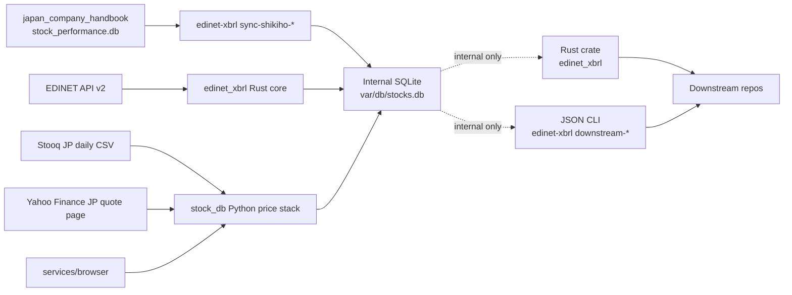
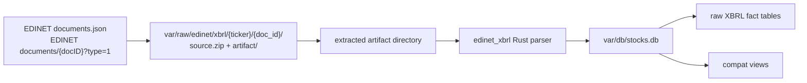
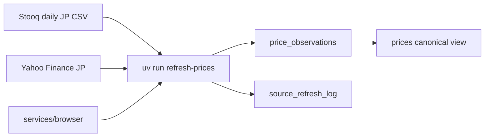
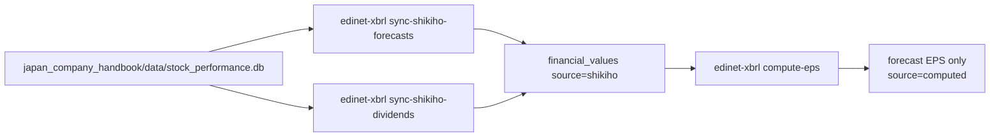

# Architecture

`stock_db` は日本株の銘柄マスタ, 株価, EDINET XBRL, 四季報由来データを SQLite に集約し, 下流 repo へ Rust crate と JSON CLI を公開するデータ基盤 repo である.

## 1. Current state

2026-08 時点の現行方針は次の通りである.

- EDINET XBRL core は pure Rust である. 公開単位は Rust crate `edinet_xbrl` と CLI binary `edinet-xbrl` である.
- PyO3/maturin extension layer は復活させない. Python から Rust core を import する公開 API は提供しない.
- Python package `stock_db` は Stooq/Yahoo Finance JP の価格取得, browser service client, refresh orchestration, 既存 DB/レポート helper を担う.
- EDINET の現行 core path は EDINET API v2 である. 書類一覧は documents.json, XBRL ZIP は documents/{docID}?type=1 を使う.
- `stock_db.api` は公開境界ではない. 下流 repo は Rust crate または `edinet-xbrl downstream-*` JSON CLI に依存する.
- SQLite schema と DB path は内部実装である. 下流 repo は `stocks`, `financial_items`, `prices` などの table/view を直接の契約にしない.
- taxonomy/XBRL 変更では IFRS, J-GAAP, US-GAAP と古い XBRL tag を壊さないことを優先する.
- canonical BS/PL/CF は連結 context のみで構成し, 単体 context で欠損を補完しない.
- historical basic/diluted EPS は提出された XBRL fact を正本とし, 期末発行済株式数から再計算しない.

## 2. Repository boundaries



`stock_db` owns data acquisition, normalization, and persistence. Downstream repos own product-specific UI, ranking, screening, and export logic.

## 3. Runtime components

### 3.1 Rust crate and CLI

`rust/` contains package `edinet-xbrl`.

- Library crate name: `edinet_xbrl`.
- Binary name: `edinet-xbrl`.
- Main modules: `edinet`, `db`, `schema`, `downstream`, `screening`, `price_lookup`, `shikiho`, taxonomy and XBRL parsers.
- Dependencies include `quick-xml`, `encoding_rs`, `zip`, `rusqlite`, `reqwest`, `clap`, `serde`, `chrono`, and `rayon`.
- The crate is pure Rust. It does not expose a PyO3 Python extension.

Representative Rust CLI commands are:

```bash
edinet-xbrl download-xbrl --doc-id DOCID --ticker 7203
edinet-xbrl scrape-historical --years 10
edinet-xbrl parse-xbrl-financials --ticker 7203
edinet-xbrl inspect-stock-db 7203 --limit 10
edinet-xbrl init-db
edinet-xbrl sync-shikiho-forecasts
edinet-xbrl sync-shikiho-dividends
edinet-xbrl compute-eps
edinet-xbrl audit-xbrl-taxonomy --format json --output result/taxonomy-audit.json
```

When running from a checkout without installing the binary, use:

```bash
cargo run --manifest-path rust/Cargo.toml -- <subcommand> ...
```

### 3.2 Python package

`src/stock_db/` remains for price ingestion and operational helpers.

Current Python entry points are defined in `pyproject.toml`.

```bash
uv run scrape-stooq-prices
uv run scrape-yahoo-finance-prices
uv run refresh-prices
uv run scheduled-refresh-prices
uv run report-edinet-progress
uv run purge-irbank-financials
uv run seed-edinet-code-list
uv run generate-validation-site-list
uv run plot-xbrl-pl-trends
```

Python EDINET helper code may still exist for compatibility or migration residue, but the current EDINET core path is the Rust `edinet` module and EDINET API v2.

### 3.3 Browser service

`services/browser/` is a local Node.js service for pages that need browser automation. It uses Express and `puppeteer-real-browser`.

Supported endpoints are:

- `GET /health`.
- `POST /fetch`.
- `POST /download`.
- `POST /evaluate`.
- `POST /stooq/prepare-daily-download`.
- `POST /stooq/complete-daily-download`.
- `POST /stooq/close-session`.
- `POST /shutdown`.

The browser service is part of the Python price stack. The EDINET Rust core does not depend on browser automation.

## 4. Data flows

### 4.1 EDINET XBRL



The Rust EDINET module downloads and extracts XBRL packages, records `sec_report_records`, and parses artifacts into normalized tables. The raw BS/PL/CF tables preserve reporting scope, full period start/end dates, duration days, context and dimensions, taxonomy QName, actual unit and unit reference, XBRL `decimals`, and value. `JPY/share` is distinct from monetary JPY and share-count units.

Canonical BS/PL/CF values are built only from consolidated contexts. Non-consolidated facts remain available in raw/audit data but never fill holes in a consolidated history. Historical basic and diluted EPS are normalized from reviewed J-GAAP, IFRS, and US-GAAP XBRL tags.

Inventory totals require an explicit total fact or an authoritative calculation/presentation-linkbase relationship. Component-only disclosures are not summed heuristically.

### 4.2 Prices



`price_observations` preserves observations from all sources. The `prices` view chooses one source per ticker/date by an explicit source priority instead of mutating an `is_canonical` flag. Stooq is the primary daily JP price source. Yahoo Finance JP is the next source for supported tickers. Price scraping is serial by design and should preserve external-site delay behavior.

### 4.3 Shikiho and computed data



Shikiho sync imports forecast net income and dividends from the upstream handbook DB. `compute-eps` computes only forecast `eps_current` and `eps_next`. Historical EPS is never derived from period-end shares because basic EPS requires an accounting-standard numerator and weighted-average ordinary-share denominator.

## 5. SQLite storage model

`var/db/stocks.db` is the default internal SQLite DB. Rust and Python both initialize it from the same versioned SQL resources under `src/stock_db/storage/sql/`.

The current schema version is `3` and is stored in SQLite `PRAGMA user_version`. Initialization is transactional. A non-empty database with another schema version is rejected instead of being migrated heuristically. Rebuild it explicitly from source data.

Base tables include:

- `data_sources`.
- `stock_entities`.
- `stock_share_counts`.
- `price_observations`.
- `unresolved_price_observations`.
- `source_refresh_checks`.
- `financial_item_defs`.
- `financial_values`.
- `xbrl_balance_sheet_facts`.
- `xbrl_profit_loss_facts`.
- `xbrl_cash_flow_facts`.
- `xbrl_statement_presentation_edges`.
- `share_class_defs`.
- `share_class_issuances`.
- `preferred_share_text_blocks`.
- `preferred_share_term_facts`.
- `potential_equity_instruments_raw`.
- `potential_equity_status_raw`.
- `diluted_eps_adjustments_raw`.
- `sec_report_records`.

Compatibility views include:

- `stocks`.
- `prices`.
- `financial_items`.
- `canonical_financial_items`.
- `share_classes`.
- `preferred_share_terms`.
- `preferred_share_dilution_terms`.
- `potential_equity_instruments`.
- `potential_equity_status`.
- `diluted_eps_adjustments`.
- `source_refresh_log`.
- `sec_reports`.

Rows whose ticker is not present in `stock_entities` are quarantined in `unresolved_price_observations` instead of becoming orphan prices.

`canonical_financial_items` applies an explicit accounting read policy. Historical BS/PL/CF, including reported basic/diluted EPS, come from `edinet_xbrl`. Forecast and dividend values come from Shikiho, except forecast EPS, which is computed from the selected forecast and current share count. Overlapping values cannot win through insertion order.

Potential-equity and diluted-EPS evidence may appear in multiple text blocks. Screening aggregates the evidence by economic identity, `instrument_key` or `adjustment_key`, rather than by text source. Conflicting quantifications are returned as unresolved instead of being added together.

The compat views are internal compatibility surfaces for this repo. They are not a downstream contract.

## 6. Public interfaces

### 6.1 Downstream JSON CLI

Downstream repos should use JSON CLI commands instead of reading SQLite directly.

```bash
edinet-xbrl downstream-all-tickers
edinet-xbrl downstream-stock-names
edinet-xbrl downstream-stock-price-metadata
edinet-xbrl downstream-screening-tickers --limit N
edinet-xbrl downstream-screening-stocks
edinet-xbrl downstream-stock-market-caps --max-age-days N
edinet-xbrl downstream-latest-xbrl-artifacts
edinet-xbrl downstream-balance-sheet-histories --n-periods N --source edinet_xbrl
```

Ticker-list commands read either a JSON array or `{ "tickers": [...] }` from stdin.

`downstream-screening-stocks` returns `ScreeningStock` records containing ticker, name, latest price, price date, shares outstanding, latest financial values, CF history, PL history, dividend history, potential equity summary, and diluted EPS common-share increase.

### 6.2 Rust API

Downstream Rust code can use the `edinet_xbrl` crate. The important stable modules are:

- `screening`, for screening read models.
- `price_lookup`, for exact-date stock price lookup.
- `downstream`, for JSON-compatible read helpers.

Representative functions are:

```rust
edinet_xbrl::screening::load_default_screening_stocks(...)
edinet_xbrl::price_lookup::load_default_stock_price_on_date(...)
edinet_xbrl::price_lookup::load_stock_price_on_date(...)
```

Parser internals may change. Treat high-level screening and downstream read models as the intended public surface.

## 7. Operational notes

Manual price refresh:

```bash
uv run refresh-prices --headless
```

Stooq-only refresh:

```bash
uv run scrape-stooq-prices --headless
```

Yahoo refresh:

```bash
uv run scrape-yahoo-finance-prices --headless
```

EDINET historical refresh:

```bash
cargo run --manifest-path rust/Cargo.toml -- scrape-historical --years 10
cargo run --manifest-path rust/Cargo.toml -- parse-xbrl-financials
```

Downstream JSON refresh helper:

```bash
uv run python services/downstream_refresh.py
```

`services/downstream_refresh.py` currently runs refresh/export commands for `formula_screening`, `land_value_research`, and `invest_like_legends` in sequence.

## 8. Development and validation

Recommended checks are:

```bash
uv run pytest
cargo test --manifest-path rust/Cargo.toml
npm test --prefix services/browser
```

Documentation consistency checks:

```bash
rg -n "PyO3|maturin|uv run parse-xbrl|uv run scrape-edinet|stock_db.api" ARCHITECTURE.md
rg -n "downstream-|edinet-xbrl|schema_base|schema_views" ARCHITECTURE.md
```

When changing taxonomy or XBRL parsing:

- Preserve IFRS, J-GAAP, and US-GAAP behavior.
- Preserve support for old XBRL tags needed for long historical backfills.
- Add static snapshot or unit-test coverage before relying on new canonical taxonomy mappings.
- Preserve reporting scope, duration, unit, and declared XBRL precision when retaining raw facts.
- Keep downstream public boundaries limited to `edinet_xbrl` and `edinet-xbrl downstream-*`.

## 9. Design constraints

- Do not restore `stock_db.api` as a downstream API.
- Do not make downstream repos depend on internal SQLite paths or table schemas.
- Do not reintroduce PyO3/maturin unless the repository policy is explicitly changed.
- Prefer pure Rust for EDINET XBRL core, schema initialization, Shikiho sync, forecast EPS computation, and downstream read models.
- Keep Python price scraping operational but narrow in scope.
- Do not use non-consolidated data as an implicit fallback for canonical consolidated statements.
- Do not infer inventory totals by summing overlapping component concepts without an authoritative relationship.
- Scraping and external access must remain conservative, serial where necessary, and respectful of configured delays.
