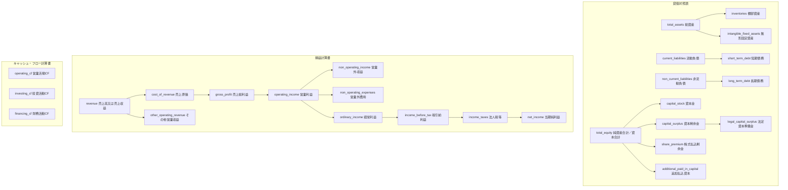

# Taxonomy accounting terms

この文書は`src/stock_db/storage/taxonomy.json`の`canonical_fields`を読むための補助資料である. 実装上の正はJSONであり, この文書は代表項目の意味と注意点だけを説明する.

## 代表項目

| canonical field | 日本語ラベル | 主な基準 | 注意点 |
|---|---|---|---|
| `inventories` | 棚卸資産（事務用消耗品等を含む） | J-GAAP, IFRS, US-GAAP | J-GAAPでは企業会計基準第9号第3項により, 売却予定がなくても販売活動及び一般管理活動で短期間に消費される事務用消耗品等を含む. IFRS IAS 2では通常の事業過程で販売目的に保有される資産, 生産過程にある資産, 生産又はサービス提供で消費される材料及び貯蔵品を対象にする. |
| `revenue` | 売上高又は売上収益 | J-GAAP, IFRS, US-GAAP | JP-GAAPの売上高, 業種別営業収益(建設・不動産等の`OperatingRevenue1`を含む), 金融業の経常収益, IFRSの売上収益を正規化する. EDINETでは業種や基準によりタグが分かれる. |
| `other_operating_revenue` | その他営業収益 | J-GAAP | 主たる売上高又は売上収益そのものではなく, 営業活動内の付随収益又は業種別の収益内訳を保持する. `RevOA`, `ORElectricELE`, `RevenueShipping`などの役割又は業種suffixを持つcomponent aliasはここへ集約する. |
| `non_operating_income` | 営業外収益 | J-GAAP | 営業活動以外から生じる収益項目. 電力業等の`NORELE`やSPFの財務収益など, 営業外収益系のタグを`revenue`へ混ぜない. |
| `non_operating_expenses` | 営業外費用 | J-GAAP | 営業活動以外から生じる費用項目. 財務費用などをPLの営業外費用として保持する. |
| `capital_stock` | 資本金 | J-GAAP, IFRS, US-GAAP | 会社法445条の資本金に対応する払込資本. IFRSでは`IssuedCapital`を同じ概念へ正規化する. |
| `capital_surplus` | 資本剰余金 | J-GAAP | 会社法445条の資本準備金を含み得る資本取引由来の剰余金. IFRSの`SharePremium`とUS-GAAPの`AdditionalPaidInCapital`は会計上似た払込資本系項目であるが, 表示名と範囲を保持するため別fieldへ分ける. |
| `share_premium` | 株式払込剰余金 | IFRS | IFRSのshare premiumを保持する. J-GAAPの`capital_surplus`へ無条件に潰さない. |
| `additional_paid_in_capital` | 追加払込資本 | US-GAAP | US-GAAPのAPICを保持する. `capital_surplus`へ無条件に潰さない. |
| `legal_capital_surplus` | 法定資本準備金 | J-GAAP | 会社法445条に基づく資本準備金の法定性を明示するため, `capital_surplus`とは別項目にする. |
| `long_term_debt` | 長期債務 | J-GAAP, IFRS, US-GAAP | 1年超の返済期限を持つ借入金, 社債, その他の有利子負債を含む. IFRSの`BondsAndBorrowingsNCLIFRS`を含む. |
| `short_term_debt` | 短期債務 | J-GAAP, IFRS, US-GAAP | 1年以内の返済期限を持つ借入金, 社債, 関係会社短期債務などを含む. 流動性を持つ有利子負債として`current_liabilities`全体とは分ける. |
| `intangible_fixed_assets` | 無形固定資産 | J-GAAP | J-GAAPの無形固定資産区分を正規化する. IFRSの`IntangibleAssets`はgoodwillの表示方法により範囲が異なるため, `intangible_assets` identityとして扱い, 無条件にここへ潰さない. |
| `cost_of_revenue` | 売上原価 | J-GAAP, IFRS, US-GAAP | 売上高又は売上収益に対応する原価. IFRS/US-GAAPのcost of sales又はcost of revenue系タグも正規化する. |
| `gross_profit` | 売上総利益 | J-GAAP, IFRS, US-GAAP | `revenue - cost_of_revenue`に対応するPL項目. XBRL上は直接タグとして出る場合を正規化する. |
| `income_taxes` | 法人税等 | J-GAAP, IFRS, US-GAAP | J-GAAPの法人税等とIFRSのincome tax expense系タグを税金費用として正規化する. |

## 財務諸表上の位置

## 参照元

- [Axiora EDINET for Developers](https://axiora.dev/en/blog/edinet-for-developers), EDINETの複数会計基準, 業種別タグ, context解決の注意点.
- [ASBJ 企業会計基準第9号](https://www.asb-j.jp/jp/accounting_standards_system/details.html?topics_id=24), 棚卸資産の範囲.
- [IFRS Foundation IAS 2](https://www.ifrs.org/issued-standards/list-of-standards/ias-2-inventories/), inventoriesのIFRS上の範囲.
- [e-Gov 会社法](https://laws.e-gov.go.jp/law/417AC0000000086/), 会社法445条の資本金及び準備金.
